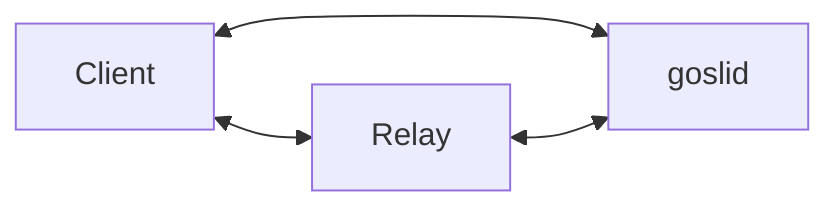

# Architecture

Gosli is a self-hosted, client-server system that provides remote terminal access to existing development environments.

## Components

### Server (`goslid`)

A lightweight daemon running on the host machine where projects and development tools already exist.

Responsibilities:
- Manage terminal sessions using PTYs (pseudo-terminals).
- Provide project-aware navigation without manual `cd` commands.
- Launch terminal sessions in the selected project's working directory.
- Expose terminal sessions to remote clients over authenticated, encrypted WebSocket connections.

### Client

A web or mobile application with a built-in terminal emulator.

Responsibilities:
- Display available projects.
- Open remote terminal sessions within a selected project.
- Send terminal input and render terminal output.
- Communicate with `goslid` over secure WebSocket connections.

## Communication

Clients connect to goslid directly or through a relay when direct connectivity is unavailable.

